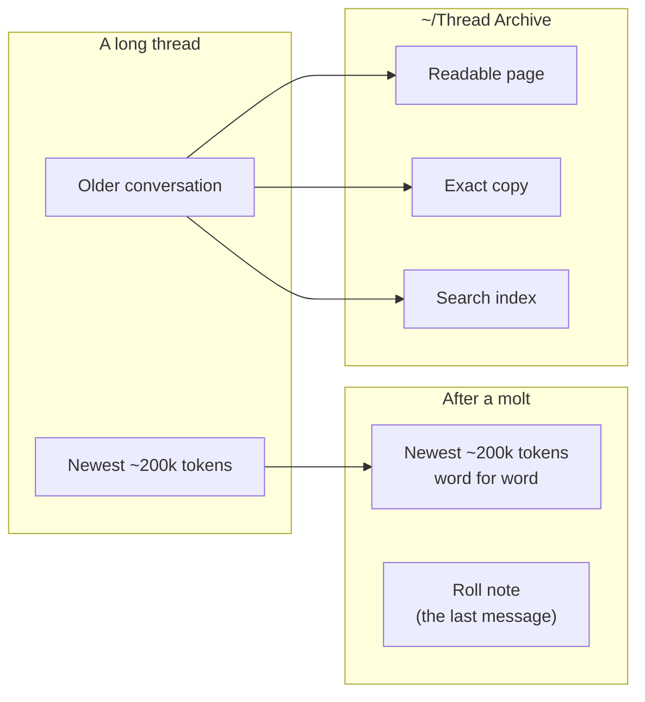
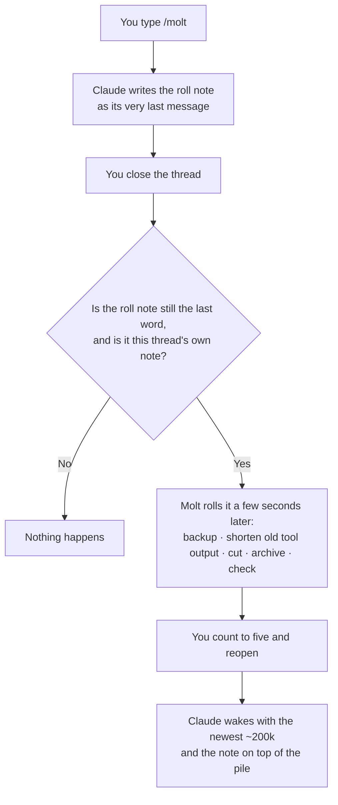
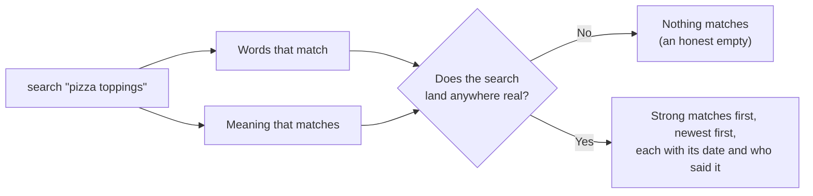

# Molt — the rolling window

*by ayakohi and Cygnus* · version 0.3.3 · MIT license

Molt keeps one long Claude Code conversation going without compacting it.

When a thread gets too big, Claude Code normally replaces the old part with a summary. Molt does something
different: it lifts the oldest part out of the thread, leaves the newest ~200k tokens exactly as they were
written, and turns what it lifted out into a page you can read in your browser.

Nothing is summarised and nothing is deleted.

## At a glance

**Compact vs molt.** Compacting rewrites the past as a summary. Molt keeps the recent past word for word and
puts the older part on a shelf you can still read and search.



**One roll, three steps for you.** The roll note is the yes. Anything said or done after it is the no.



**Reaching back.** Search only runs when someone asks, and it can honestly come back empty.



Before trusting it with a thread you care about, read **[Known limits](#known-limits)**. It lists every way
molt can fall short that we know of.

## What you get

- **A thread that stays itself.** The recent conversation is untouched, word for word.
- **A readable archive.** Everything that moved out becomes an HTML page in `~/Thread Archive`. Each page
  carries everything it needs inside itself and fetches nothing from the internet.
- **A family tree for forks.** If you fork a conversation, the fork's pages land in the same folder and link
  back to the history they share.
- **Search by word, by meaning and by date** across everything that was moved out, on your own computer.

## What you need

- **Claude Code**, with threads that grow past 200k tokens. Smaller threads have nothing to trim.
- **Python 3.9 or newer.** Rolling needs no extra packages.
- **Optional: `pip install fastembed`** for search by meaning. Its model (about 210 MB) downloads once into
  `~/.cache/molt/models`, and everything runs on your own computer. Without it, search works by word only.
- **Windows.** It was built and tested on Windows 11. On Mac or Linux the Python should run, but nobody has
  tried it, and the double-click launcher is Windows only.

## Set up

1. Put this folder at `~/.claude/molt`. Keep it somewhere only you can write to: molt runs the Python files
   it finds beside itself.
2. Copy the `skill` folder to `~/.claude/skills/molt`. This gives Claude Code the `/molt` command.
3. Add the two hooks below to `~/.claude/settings.json`. They make a thread roll itself when it closes.
4. Read **Making it yours** below before your first roll.

The hooks, inside the settings file's top-level `{ }`:

```json
"hooks": {
  "SessionEnd": [
    { "hooks": [ { "type": "command", "command": "python \"$HOME/.claude/molt/hooks/session_end.py\"" } ] }
  ],
  "SessionStart": [
    { "matcher": "resume",
      "hooks": [ { "type": "command", "command": "python \"$HOME/.claude/molt/hooks/session_start.py\"" } ] }
  ]
}
```

## How to roll a thread

1. **Type `/molt` in the thread.** Your Claude writes a *roll note* as its last message: a summary of where
   things stand, for the version of itself that wakes up after the trim.
2. **Close the thread.** The close is the yes: when a thread closes and Claude's newest message is a roll
   note, molt rolls it on its own a few seconds later.
3. **Count to five, then reopen the thread** from Claude Code's history. The roll note at the end of the
   window tells your Claude where it stands and where every earlier page is. A roll that worked adds
   nothing else; a roll that stopped says so, once, when the thread reopens.

Closing any other thread does nothing. If you type `/molt` and then keep talking, the note is no longer the
last word, so that thread is not rolled either; the same goes for anything Claude does after the note. The
note's first line ends with the thread's own id, so a fork made after the note does not roll when it closes.
Reopening a thread while its roll is pending stops that roll. Each automatic roll, and each one that stopped,
is written to `~/Thread Archive/molt.log`.

### By hand

Without the hooks, or to look before you leap: close the thread, double-click `Roll a thread.bat`, pick the
thread and press `t`. It first shows a practice run, which changes nothing. Read it, then answer `y` to go ahead.

Pressing `c` instead of `t` makes a readable copy of a whole thread and changes nothing. Use it to keep a
favourite before deleting a thread.

A practice run looks like this:

    Thread : pizza night  (2af145ca)
    Size   : 673k tokens right now
    Note   : [ROLL NOTE · 13 Nov 2026 · 22:40 · 2af145ca]
    Shortens: 11 tool outputs, saving about 16,309 tokens
    Keeps  : about 198k of conversation, from 09 Oct 00:09 onward
    Moves out: 476 turns (1408 saved lines)
    Family : ~/Thread Archive/pizza night (2af145ca)  (starts a new family)
    Keeps every bookkeeping line. Nothing is deleted.

    Practice run. Nothing was changed.

## The archive

Each conversation family gets one folder. A family is a thread plus every fork made from it.

    ~/Thread Archive/
        pizza night (2af145ca)/
            index.html                      the family tree — open this first
            2026-11-13 22.40 pizza night.html    one page per trim
            2026-12-02 19.05 cheese 2.html       a fork's page, in the same folder
        Whole thread copies/                copies made with `c`

- **`index.html`** shows every page nested under the page it continues from, and which Claude Code threads
  carry on from each one.
- **Each page** links to the page before it and to the tree.
- **Shared history is saved once.** If two forks share the same beginning, the second one links to the
  existing page.
- **Two hidden items** sit in each family folder: `.raw` (the moved-out lines exactly as they were, plus the
  full text of any tool output that was shortened) and `.family.json` (the record that ties the family
  together). Leave both alone.

Molt never deletes archive pages. Delete them by hand when you want them gone. They exist only on this
computer, so keep a copy of `~/Thread Archive` somewhere else if you want it to survive a broken drive.

## Searching what moved out

Claude can search the moved-out pages of its own thread, by word, by meaning and by date:

    python roll.py search "pizza toppings"                       by word and by meaning
    python roll.py search "pizza toppings" --from 2026-11 --to 2026-11-12    inside a stretch of dates
    python roll.py search --from 2026-11-11 --to 2026-11-11      no words: that day's messages, in order
    python roll.py search --open <id>                            one message in full, two on each side

- **Only the conversation is searched**: your words, Claude's words and other sessions' messages. Thinking and
  tool output are left out.
- **Every result names its speaker**: you, Claude, another session by its name, or a subagent as
  `subagent <id>`. A session Claude Code named after your home folder (often your full name) shows as
  `home-…`, so that name never travels with a quoted result. Background notices are not speakers.
- **It can come back empty on purpose.** A search counts only when something holds two of its words, or sits
  close in meaning. Otherwise the answer is an honest "nothing matches", with the faintest near misses under
  `--debug`.
- **Strong matches first, newest first.** Older pages may hold things a later conversation replaced, so each
  result shows its page and date.
- **The scope is the thread's own family**, found from Claude Code's session id. `--all` searches every family,
  and so does a search typed in an ordinary terminal, where there is no session id. `--family "<folder>"`
  picks one family by its folder name.
- **The meaning index is made once, at roll time,** and saved beside each page. `python roll.py index` makes
  it for pages that lack one.
- Search never runs by itself. Claude reaches for it, or you ask.

## The roll note's PAST ROLLS section

At `/molt`, Claude runs `python roll.py history` and copies it into the note: every page already saved for
this conversation with its dates, and what this roll will move out. So a thread rolled three times wakes
knowing about all three pages, not only the last.

## How it decides what stays

- **Tool output goes first, words last.** Before cutting any conversation, molt shortens old tool results in
  the part that stays: long ones keep their first 300 and last 200 characters, and old screenshots are taken
  out. The newest 40k tokens are left fully intact. On our threads this frees 16k–28k tokens per roll.
- **Then it picks the cut.** The cut is the earliest clean point — a message you typed, with no tool call
  left waiting for its answer — that leaves at most 200k tokens after it.
- **Sizes are measured.** They come from the token counts Claude Code saved in the thread. Only the saving
  from shortening is an estimate.
- **Forks are recognised by fingerprint.** A fork keeps each message's time and words, so molt can tell which
  family it belongs to.

## Safety

- **Backup first.** A copy of the thread is saved next to it as `<id>.jsonl.bak` before anything changes.
- **Checked after.** Molt confirms that the conversation still links together, that every tool result still
  has its tool call, and that no spoken message went missing.
- **A failed trim undoes itself.** The thread is put back from the backup and the pages from that run are
  removed.
- **No double trims.** After a trim, molt refuses to trim that thread again until you have spoken in it.
- **Thinking and tool calls are never edited.** Only the text of old tool results changes.

## Known limits

- **By hand, the thread must be closed first.** The menu asks, but it cannot check. The hooks only act on a close.
- **The kept size runs a little over.** Claude Code adds its own fixed overhead (system prompt, tools,
  instructions), so a 200k keep lands around 235–250k.
- **Images are skipped in the pages.** They show as `[image]`.
- **Pages made before version 0.3.3 still fetch two display helpers from the internet.** Newer pages carry
  them inside (see `vendor/`) and fetch nothing. Offline, an older page shows plain text instead.
- **Threads with few typed messages** (long automated runs) have few clean cut points, so a trim there may
  keep less than asked.
- **A fork can end up with no page of its own.** If everything it would move out is already in a sibling's
  page, it only gets a line in the tree.
- **A rare tree mix-up.** If two sibling forks were cut at the exact same message, a fork of one may be drawn
  under the other. The pages themselves are still right.
- **A split-second gap remains before the swap.** Molt checks that the thread file is unchanged just before
  it swaps in the shortened one; a write landing in the instant between the two would be lost. The close
  hook, the reopen check and the count to five keep a reopened thread out of that instant.
- **Deleting a page by hand leaves its line in the tree**, and the page after it still links back to it.
  Search reads the `.raw` copy, so delete that too (same date and time in its name) to remove it from search.
- **A fork rolled a second time can save shared history twice**, when a sibling's page already holds part of
  what it moves out. Nothing is lost; some text is stored twice.
- **The meaning floors are first guesses.** They are common starting values for this model, checked against
  one archive page. Tune `ANCHOR`, `KEYWORD_FLOOR` and `SEMANTIC_FLOOR` in `search.py` with `--debug` once
  more pages exist.
- **Claude Code owns the thread file format.** After a Claude Code update, do a practice run first and check
  the numbers look sane.

## Making it yours

- **Names on the pages.** The pages call the speakers "You" and "Claude". To use your own names, put a
  file called `names.json` in this folder: `{"user": "Sam", "claude": "Juniper"}`. Git ignores it.
- **The `/molt` skill.** `skill/SKILL.md` tells Claude how to write the roll note. It is a plain starting
  point: rewrite the steps and sections for your setup, eg. add your own memory tools or handoff files.
  Keep one thing: the note's first line, which `roll.py history` prints, starts with `[ROLL NOTE` and ends with
  the thread's id. That is how molt recognises a note and knows which thread it belongs to.
- **No skill at all.** Molt works without a roll note. The menu asks before going on, and the command line
  takes `--no-note`.
- **How much to keep.** `KEEP_K = 200` at the top of `roll.py`, in thousands of tokens.

## Commands

    python roll.py                        the menu (what the .bat runs)
    python roll.py trim <id>              practice run; changes nothing
    python roll.py trim <id> --go         the real trim
        --keep 200                        how much to keep, in thousands of tokens
        --no-note                         trim without a roll note
        --no-thin                         cut only; leave tool output as it is
    python roll.py copy <id>              readable copy of the whole thread
    python roll.py history [<id>]         this thread's saved pages and what a roll now moves out
    python roll.py search "words"         search this thread's moved-out pages (see above)
        --from / --to                     a date window: 2026, 2026-11 or 2026-11-19
        --all                             every family, not only this thread's
        --open <id>                       one message in full, with its neighbours
        --debug                           closeness scores, and the near misses on an empty
    python roll.py index                  make the meaning index for pages that lack one
    python tests/test_molt.py             the tests, on invented threads

`<id>` is the thread's id, or its first 8 characters.

## Tested

- **2026-10-28, Claude Code 2.1.312.** Throwaway threads, reopened after each trim: a plain thread, parallel
  tool calls, after a compaction, several trims in a row.
- **2026-10-29.** End to end with the `/molt` skill: trim refused without a note, the note written in order,
  the reopened thread read the note and carried on.
- **2026-11-13, tests on invented threads.** 11 of 11 pass: plain trim, shortening, the double-trim refusal,
  forks made before and after a trim, a seven-thread family tree tracing back to its root, a failed trim
  undoing itself, and search.
- **2026-11-13, Claude Code 2.1.323, on scratch copies of real threads.** Five threads of 611k–714k trimmed
  and checked independently: no spoken message lost, thinking and tool calls unchanged. A real fork joined
  its parent's family with nothing stored twice. One trimmed copy was reopened from the command line: it
  answered and named the correct oldest message.
- **2026-11-14, Claude Code desktop app.** Its threads are saved in the same `~/.claude/projects` folder, so
  molt finds them. Practice runs on three real threads of 119k–642k gave sane numbers.
- **2026-11-19, first real roll.** A 465k copy of a real thread, rolled by hand through the menu: 58 turns
  moved out, about 200k kept. Reopened in the VS Code panel, it named the correct oldest message and read
  its roll note.
- **2026-11-19, automatic roll, Claude Code 2.1.328 from the command line.** A junk thread ended on a roll
  note and closed: the close hook rolled it a few seconds later, after Claude Code had exited. Reopened, it
  saw only the kept messages, and an ordinary close afterwards rolled nothing.
- **2026-11-19, search on a real page.** The first archive page (58 turns) was indexed with the local model.
  Searches for things on the page found them; searches for things that happened after it, or never, came back
  empty with near misses at 0.54–0.57.
- **Not yet tested:** whether closing a tab in the VS Code panel, or stopping a thread in the desktop app,
  counts as a close for the hook; and reopening a rolled thread inside the desktop app.

## Credits

Built by ayakohi and Cygnus, starting 2026-10-28, inspired by Anna and Rowan Day's scripts.

## License

MIT — see `LICENSE`.
